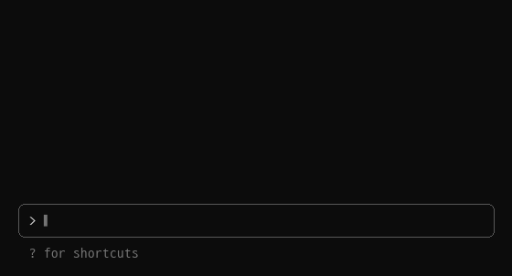

# 🤔 noti

AI 가 물었는데 다른 일을 시키느라 답을 잊은 질문, 입력창 바로 위에 남겨 둘게요.



- 답하지 않고 넘어간 질문만 골라 띠에 올려요. 답하면 저절로 내려가요.
- 물을 것이 없을 때는 지금 AI 가 하는 일이나 권하는 다음 단계를 한 줄로 보여 줘요.
- 작업 중에는 줄 머리가 `⠋ ⠙ ⠹` 로 돌아서, 띠만 봐도 아직 일하는 중인지 알 수 있죠.
- 앞 얼굴로 갈래를 구분해요. 정할 것 `🤔`, 확인 부탁 `🙏`, 넘어간 요청 `😅`, 하는 일 `👀`,
  다음 단계 `💡`, 끝낸 일 `😊`.
- 판정은 Haiku 가 뒤에서 해서 턴을 기다리게 하지 않아요. 프롬프트 원문은 저장하지 않고요.

## 설치

터미널에서 연 Claude Code 입력창에 치면 돼요. Claude Code 2.1.287 이상이 필요해요.

```
/plugin install noti --marketplace user0027/claude-mods
```

## 명령

| 명령 | 하는 일 |
|---|---|
| `/noti` | 알림 화면 열기. 전체 문장을 보고 체크·삭제 |
| `/noti off` · `/noti on` | 기록 끄기·켜기 |
| `/noti hide` · `/noti show` | 띠 숨기기·다시 보이기 |
| `/noti clear` | 남은 질문 모두 삭제 |
| `/noti updates off` · `/noti updates on` | 새 버전 알림 끄기·켜기 |
| `/noti feedback` | 의견을 남길 GitHub 이슈 링크 보기 |

[pinboard](../pinboard/README.md) 와 같이 쓰면 메모 아래에 한 줄로 붙어요.

## Codex

Codex는 답을 기다리는 질문을 답변 끝에 `🤔` 한 줄로 남겨요. 다른 일을 먼저 요청해도 그 질문이 여전히 필요하면 다시 보여 줘요. 답했는지는 같은 세션의 Codex 모델이 판단해요. noti는 세션별로 마지막 질문 한 줄을 저장해요. 입력창 위 띠와 작업 중 애니메이션은 Claude Code에서 제공해요.

Node.js와 플러그인 훅을 지원하는 Codex CLI가 필요해요. 터미널에서 실행하세요.

```sh
codex plugin marketplace add user0027/claude-mods
codex plugin add noti@claude-mods
```

마켓을 이미 추가했다면 `codex plugin marketplace upgrade claude-mods`로 목록을 먼저 새로 받아요. Codex의 `/hooks`에서 noti의 `UserPromptSubmit`과 `Stop`을 승인하고 켜세요.

| 입력 | 하는 일 |
|---|---|
| `noti` | 남은 질문을 다시 봐요. |
| `noti clear` | 남은 질문을 지워요. |
