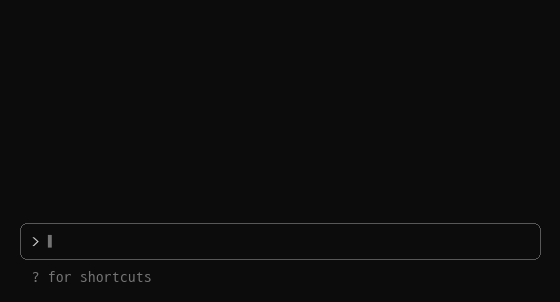

# 📌 pinboard

작업하다 잊으면 안 되는 메모를 Claude Code 입력창 바로 위에 붙여 둬요.



- `/pin 메모` 한 줄이면 입력창 위에 고정돼요. 앞에 `!` 를 붙이면 중요 메모로 빨갛게 나와요.
- 턴이 끝날 때마다 AI 가 끝난 것 같은 메모를 찾아 `🤔` 로 물어봐요. 말없이 지우지는 않아요.
- 메모는 4개까지 쌓여요. 꽉 차면 끝낸 메모부터, 없으면 가장 오래된 메모부터 밀려나요.
- 메모는 폴더별로 저장돼서, 같은 폴더에서 세션을 다시 열면 그대로 남아 있어요.

## 설치

터미널에서 연 Claude Code 입력창에 치면 돼요. Claude Code 2.1.287 이상이 필요해요.

```
/plugin install pinboard --marketplace user0027/claude-mods
```

## 명령

| 명령 | 하는 일 |
|---|---|
| `/pin <메모>` | 메모 고정. 앞에 `!` 를 붙이면 중요 표시 |
| `/pin <번호>` | 그 메모를 끝낸 것으로 표시 |
| `/pin edit <번호> <새 문구>` | 그 메모의 문구 수정 |
| `/pins` | 핀보드 화면 열기. 추가·체크·삭제를 한 화면에서 |
| `/unpin <번호>` | 그 메모 삭제. `/unpin done` 은 끝낸 것만, `/unpin all` 은 전부 |
| `/pin updates off` · `/pin updates on` | 새 버전 알림 끄기·켜기 |
| `/pin feedback` | 의견을 남길 GitHub 이슈 링크 보기 |

번호는 `/pins` 화면에 나와요.

[noti](../noti/README.md) 와 같이 쓰면 답하지 않고 넘어간 AI 질문도 같은 자리에 올라와요.
