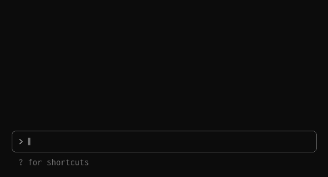

# 📌 pinboard

작업하다 잊으면 안 되는 메모를 Claude Code 입력창 바로 위에 붙여 둬요.



- `/pin 메모` 한 줄이면 입력창 위에 고정돼요. 앞에 `!` 를 붙이면 중요 메모로 빨갛게 나와요.
- 턴이 끝날 때마다 AI 가 끝난 것 같은 메모를 찾아 `🤔` 로 알려 줘요. 끝냄 표시는 `/pin <번호>` 나 `/pins` 로 직접 할 때만 해요.
- 메모는 4개까지 쌓여요. 꽉 차면 끝낸 메모부터, 없으면 가장 오래된 메모부터 밀려나요.
- 메모는 세션마다 따로 저장돼요. 다른 세션에 꽂은 메모와 섞이지 않고, `/clear`·`--resume` 뒤에도 그대로 남아 있어요.
- 입력에 '핀'이나 'pin' 이 들어가면 메모 목록이 AI 에게도 같이 넘어가요. 핀에 있던 일이 끝났는지 물어볼 수 있어요.

## 설치

터미널에서 연 Claude Code 입력창에 치면 돼요. Claude Code 2.1.287 이상이 필요해요.

```
/plugin install pinboard --marketplace user0027/claude-mods
```

## 명령

| 명령 | 하는 일 |
|---|---|
| `/pin <메모>` | 메모 고정. 앞에 `!` 를 붙이면 중요 표시 |
| `/pin <번호>` | 그 메모를 끝낸 것으로 표시 |
| `/pin edit <번호> <새 문구>` | 그 메모의 문구 수정 |
| `/pins` | 핀보드 화면 열기. 추가·체크·삭제를 한 화면에서 |
| `/unpin <번호>` | 그 메모 삭제. `/unpin done` 은 끝낸 것만, `/unpin all` 은 전부 |
| `/pin updates off` · `/pin updates on` | 새 버전 알림 끄기·켜기 |
| `/pin feedback` | 의견을 남길 GitHub 이슈 링크 보기 |

번호는 `/pins` 화면에 나와요.

[noti](../noti/README.md) 와 같이 쓰면 답하지 않고 넘어간 AI 질문도 같은 자리에 올라와요.

## Codex

Codex에서는 채팅으로 메모를 관리해요. 메모는 Codex 세션마다 따로 저장되고, 같은 세션을 다시 열면 이어서 쓸 수 있어요. 진행 중인 메모는 매 턴 Codex에 전달돼요. 이번 턴에 끝낸 일이 메모와 맞으면 답변 끝에 알려 줘요. 끝냄 표시는 직접 `pin done 번호`를 입력할 때만 바뀌어요. 입력창 위 메모 띠와 클릭으로 여는 패널은 Claude Code에서 제공해요.

Node.js와 플러그인 훅을 지원하는 Codex CLI가 필요해요. 터미널에서 실행하세요.

```sh
codex plugin marketplace add user0027/claude-mods
codex plugin add pinboard@claude-mods
```

Codex에서 `/hooks`를 열고 Pinboard의 `UserPromptSubmit` 훅을 승인하세요. 채팅에 아래처럼 입력하면 돼요.

| 입력 | 하는 일 |
|---|---|
| `pin add !배포 확인하기` | 메모를 추가해요. 앞에 `!`를 붙이면 중요 표시가 붙어요. |
| `pin list` | 메모 목록과 번호를 봐요. |
| `pin edit 2 새 문구` | 2번 메모를 고쳐요. |
| `pin done 2` | 2번 메모를 끝낸 것으로 표시해요. |
| `pin remove 2` | 2번 메모를 지워요. |
| `pin remove done` | 끝낸 메모를 지워요. |
| `pin remove all` | 모든 메모를 지워요. |

메모는 4개까지 남아요. 꽉 차면 끝낸 메모 중 가장 오래된 것이 먼저 빠져요. 모두 진행 중이면 가장 오래된 메모가 빠져요.
